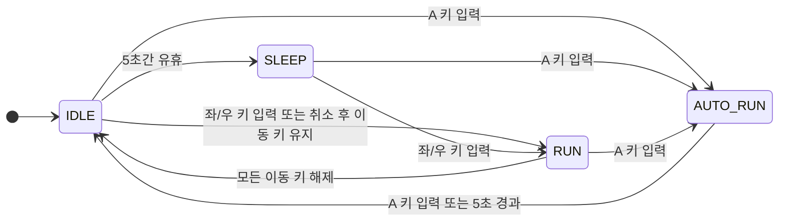

# AUTO_RUN 개발 계획

## 목표

`Boy`의 `AUTO_RUN` 상태에서 자동으로 달리고, 정해진 시간이 지나면 `IDLE` 상태로 돌아오도록 한다. 이후 자동 달리기 중 속도와 크기가 점점 커지는 효과 및 좌우 경계에서 방향을 바꾸는 동작을 추가한다.

## 현재까지 구현한 내용

- 상태 머신에 `AUTO_RUN`, `IDLE`, `SLEEP`, `RUN` 상태를 두고 상태별 전환을 구성했다.
- `A` 키를 눌러 `AUTO_RUN`을 시작한다. 다시 누르면 자동 달리기를 중단한다.
- `AUTO_RUN`은 시작 시각을 기록하고, 5초가 지나면 `IDLE`로 전환한다.
- 자동 달리기 중에는 바라보는 방향으로 이동하고 달리기 애니메이션을 재생한다.
- `AUTO_RUN`, `RUN`, `IDLE`, `SLEEP`의 상태별 동작을 각각 상태 클래스로 분리했다. 상태 머신은 상태 전환을 관리하고, 전환이 일어나면 해당 상태 객체를 교체한다.
- `AutoRunState`는 공통 달리기 동작을 재사용하면서 5초 타이머를 관리한다. 시간이 끝나면 상태 머신에 `IDLE` 전환을 요청한다.
- `AUTO_RUN` 중 속도가 기본 속도 5에서 최대 속도 10까지 5초 동안 선형으로 증가한다. 일반 `RUN`은 기본 속도 5를 사용하고, `IDLE`에 진입할 때 기본 속도로 초기화한다.
- `AUTO_RUN` 중 표시 크기가 100×100에서 150×150까지 처음 4초 동안 선형으로 커진다. 마지막 1초는 최대 크기를 유지하고, `IDLE` 진입 시 원래 크기 100×100으로 복원한다.
- `RUN`과 `AUTO_RUN`에서 x=50 또는 x=750 경계에 닿으면 경계 좌표를 유지하며 진행 방향을 반전한다.
- 좌우 화살표 키로 `RUN`을 시작하고 방향을 지정하며, 이동 키를 놓으면 `IDLE`로 돌아온다.
- `IDLE` 상태가 5초 지속되면 `SLEEP` 상태로 전환한다.
- `RUN` 또는 `AUTO_RUN` 상태에 따라 바라보는 방향에 맞는 애니메이션을 표시한다.
- 현재 이동 범위는 x 좌표 50부터 750까지이며, `RUN`과 `AUTO_RUN` 중 경계에 닿으면 진행 방향을 반전한다.

## 상태 클래스 설계

- 각 상태 클래스가 해당 상태의 업데이트 동작을 담당한다.
- `RunningState`에 공통 이동과 달리기 애니메이션을 두고, `AutoRunState`와 `RunState`가 이를 재사용한다.
- 상태 머신의 전환 트리거와 키 입력 동작은 유지한다. 상태 전환 후 `Boy`가 새 상태 객체를 선택해 다음 업데이트부터 해당 객체에 동작을 위임한다.
- 새 상태 동작을 추가할 때는 상태 클래스와 상태 이름 연결을 함께 갱신하고, 기존 전환 및 입력 동작이 유지되는지 확인한다.

## 상태 다이어그램

아래 다이어그램은 제공된 `Diagram.png`의 네 상태를 기준으로, 현재 코드에서 실제로 발생하는 상태 전이를 표시한다.

`AUTO_RUN`을 취소할 때 이동 키가 눌려 있으면 먼저 `IDLE`로 전환한 뒤 `RUN`으로 전환한다. `SLEEP`에서 이동 키를 누르면 `IDLE`을 거치지 않고 바로 `RUN`으로 전환된다. 따라서 샘플 이미지와 달리 현재 코드에는 `SLEEP`에서 `IDLE`로 직접 돌아오는 전이가 없다.

`RUN`과 `AUTO_RUN`에서 좌우 경계에 닿아 방향을 바꾸는 동작은 상태를 바꾸지 않는 내부 동작이므로 전이 화살표로 표시하지 않았다.

## 앞으로 추가할 내용

## 완료 기준

- `AUTO_RUN`은 시작 후 5초 동안 실행되고 이후 `IDLE`로 전환된다.
- `AUTO_RUN` 중 속도가 기본값 5에서 최대값 10까지 점진적으로 증가하고 `IDLE` 전환 시 기본 속도로 복원된다. **완료**
- `AUTO_RUN` 중 크기가 100×100에서 150×150까지 점진적으로 증가하고 `IDLE` 전환 시 원래 크기로 복원된다. **완료**
- `RUN`과 `AUTO_RUN`에서 좌우 경계에 닿을 때 이동 방향이 바뀌고 캐릭터가 유효 이동 범위를 벗어나지 않는다. **완료**
- 기존 키 입력, 상태 전환, 애니메이션 동작이 유지된다.
